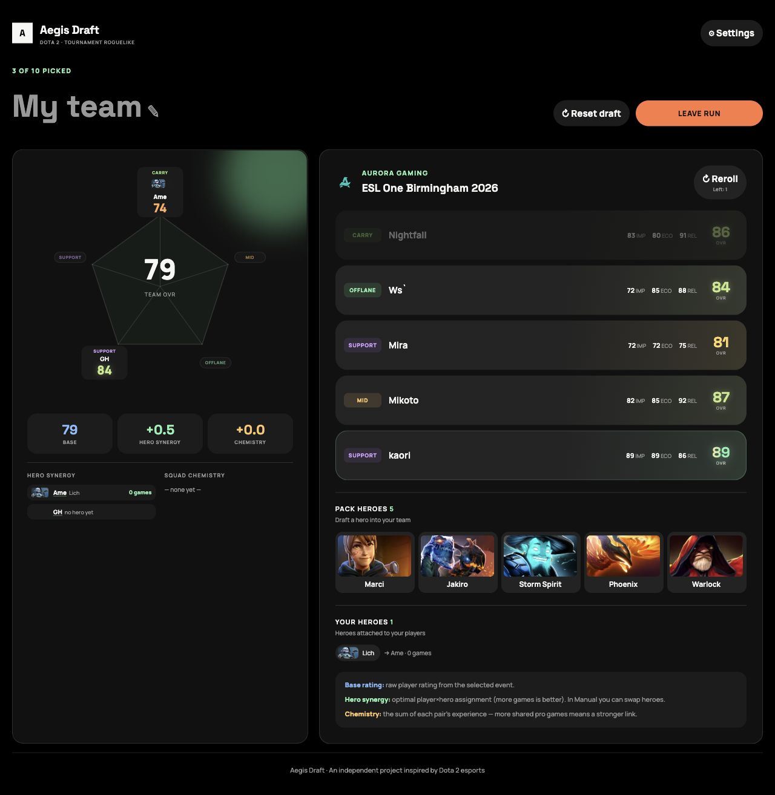
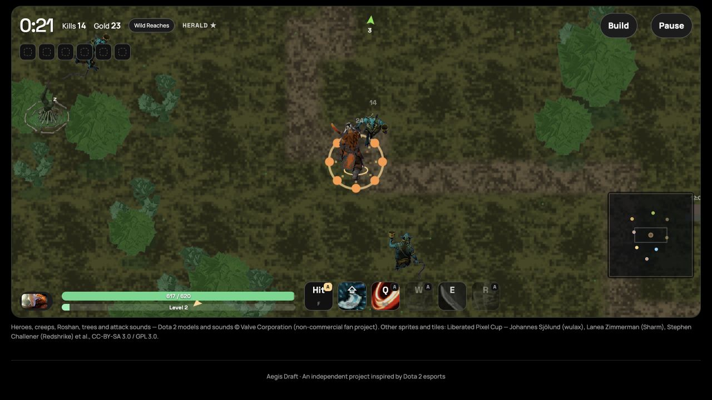

# Aegis Draft

Draft a five-player Dota 2 team from real tournament rosters and see how far it goes against the pros. Do you take the highest-rated midlaner in the pack, or save the slot for someone who played with your carry? Their history together matters. If you'd rather play a hero yourself, Arcade turns the same jungle into a real-time survival game.

**[Play Aegis Draft in your browser](https://artemchikolaev.github.io/aegis-draft/)** · English and Russian · Desktop and mobile



## Your first draft

1. Choose **Classic → Quick Draft → Team Packs**. Each pack comes from a real team's lineup at a particular event. Pick a player for an open role or take a hero. Across ten picks, fill carry, mid, offlane and two support slots, and collect five heroes.
2. Watch **Team OVR** as you draft. **Base** reflects the players' form at their events. **Hero Synergy** rewards matching a player with a hero they have played in pro games. **Chemistry** rewards pairs who played together. A familiar support duo can be worth more than an upgrade to either player alone.
3. Enter the **18-team tournament**. Follow your team through groups and see how deep it goes in the playoffs. Share the seed link if you want a friend to try the same packs and beat your finish.

## Choose a mode

| Mode | What you play for |
| --- | --- |
| **Classic** | **Quick Draft** takes one lineup through one tournament. Choose Team Packs for real rosters or Mixed Draft for players from different teams. In **Roguelite Run**, draft once, upgrade the team at camp, and meet a tougher placement target at each stage. Missing the target ends the run. |
| **Esports Manager** | Run a regional organization across a season. Scout tryouts, fit five salaries into a budget and earn entry to bigger events through qualifiers. In the off-season, decide whose contract to renew. |
| **Real Tournament** | Pick a real event and challenge its original field. The opponents keep their players, so you build your challenger from pros and legends outside those rosters. |
| **Arcade** | Take direct control of one hero. Dodge creeps, level up abilities and build toward a fight with the Ancient. |
| **Duel** | Invite a second captain with a room code. Take turns drafting from a shared pool, then ban and pick heroes for each game in a best-of-one, best-of-three or best-of-five series. Requires a connected game server. |
| **Arena** | Up to 18 teams draft from the same pool. Everyone picks simultaneously and priority reverses each round to break ties. Requires a connected game server. The public menu currently labels Arena **Soon**. |

For the same challenge as everyone else, play the **Daily** from the Classic menu. Its seed changes at midnight UTC. For a tougher solo draft, **Hard** hides player profiles and removes pack and opponent rerolls. You can resume a saved run and revisit your collection, trophies and Playbook in **HQ**.

## Inside Arcade



Here you move, attack and cast spells yourself. In this run, Juggernaut has just reached level two and taken **Ring of Fire**, which fires bolts in every direction. Another run might start with a ranged hero and spend that first upgrade on a hero ability. Survive the waves, contest Roshan for the Aegis and face the Ancient at the twenty-minute mark. Play with a keyboard, mouse, gamepad or on-screen stick.

## Run locally

The solo game uses the dataset checked into the repository. With **Node.js 24+**, run the following from the project root.

```sh
cd web
npm ci
npm run dev
```

Open [localhost:5173](http://localhost:5173). To play on a phone on the same Wi-Fi network, run `make dev-phone` from the project root and open the network address printed by Vite.

The production build is an installable PWA. Once the service worker has cached the game and its data, solo play works offline. Use `npm run preview:pages` in `web/` to try the production build under the same path as GitHub Pages.

### Development checks

Run these commands in `web/`.

| Command | What it checks |
| --- | --- |
| `npm run validate:data` | Validate the checked-in tournament dataset. |
| `npm run typecheck` | Type-check the frontend and service worker. |
| `npm test` / `npm run test:mock` | Run unit tests against real data or the deterministic fixtures used for golden tests. |
| `npm run test:e2e` / `npm run test:e2e:offline` | Exercise browser flows or check offline play against a fresh production build. |
| `npm run sim` / `npm run sim:manager` / `npm run sim:arcade` | Simulate runs without the UI to inspect game balance. |

### Code and data

| Directory | What's inside |
| --- | --- |
| [web/](web/) | React, TypeScript, Vite and Zustand. The client runs the draft, scores lineups and renders Arcade with Canvas 2D. |
| [pipeline/](pipeline/) | A Go pipeline turns OpenDota matches into versioned packs, rosters and ratings. A [scheduled workflow](.github/workflows/data-refresh.yml) refreshes the checked-in data. |
| [schema/](schema/README.md) | The JSON contract shared by the pipeline and the web client. |
| [server/](server/) | A Go API for accounts, saves and multiplayer rooms. The [local Docker Compose setup](infra/README.md) serves the game, static data and API behind one address. |

[CI and Pages deployment](.github/workflows/ci.yml) · [Server deployment](.github/workflows/deploy-server.yml) · [Offline architecture](docs/adr/0003-offline-first-pwa.md)

## Further reading

- [Game design](docs/PRD.md), [mode walkthroughs](docs/modes-scenarios.md) and [roguelite endgame](docs/roguelite-lategame-spec.md)
- [Arcade design](docs/arcade-survivors-brief.md) and [how Dota models become 2D sprites](docs/arcade-dota-sprites.md)
- [Design language](docs/design-language.md), [roadmap](docs/BACKLOG.md) and [contributor workflows](docs/ai/INDEX.md)

## Credits and license

Aegis Draft is an independent, non-commercial fan game by Artem Chikolaev, inspired by [322-0](https://322-0.app/play). The project code is available under the [MIT License](LICENSE).

Dota 2 and its models, icons and sounds belong to Valve. Match data comes from [OpenDota](https://www.opendota.com/). The project documents authorized use of [Liquipedia data](docs/LIQUIPEDIA_ACCESS.md). Additional sprites and tiles come from the Liberated Pixel Cup under CC BY-SA 3.0 / GPL 3.0. See the [artist credits and licenses](web/public/art/sprites/lpc/ATTRIBUTION.md).
